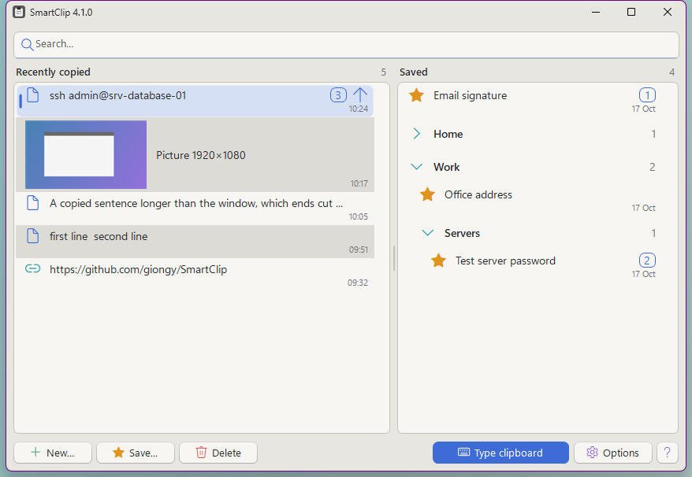
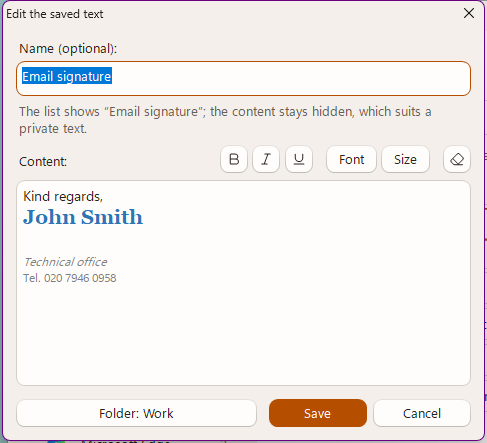
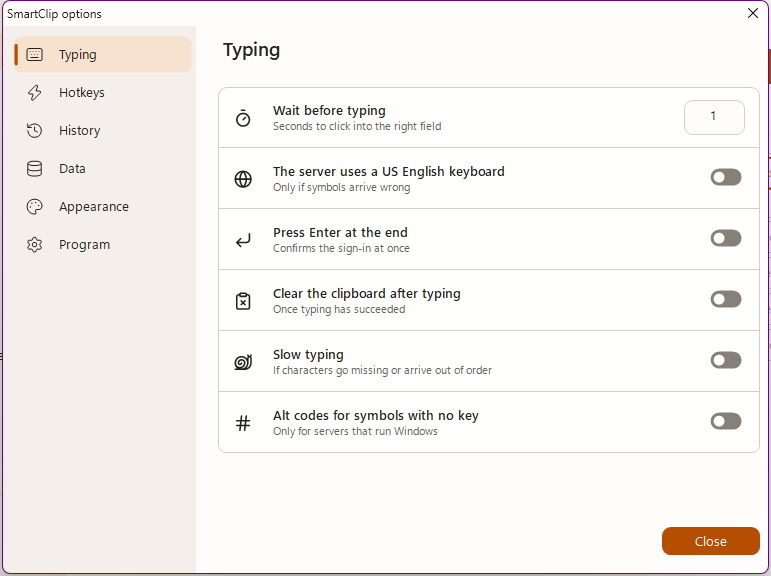

# SmartClip

[](https://github.com/giongy/SmartClip/actions/workflows/codeql.yml)

**A tiny clipboard manager that can also type the clipboard as real keystrokes, for the places where paste does
not work.**

SmartClip keeps a history of what you copied, pictures included, and the texts you choose to save. One click makes
any of them the current clipboard content again.



It also covers the moment you have a long password in your password manager and a remote login screen that ignores
Ctrl+V: remote desktop lock screens, VMware consoles, iLO / iDRAC and other KVM viewers. Instead of pasting, it
presses the keys one by one, as if you were typing.

Formerly called PasswordPaste: the first start under the new name takes over its settings and saved texts.

- One portable `.exe`, about 170 KB. No installer, no dependencies, no network access.
- A handful of C# source files in `src`, compiled with the compiler already shipped with Windows.
- Stops typing the moment the target window loses focus, so a password never lands in the wrong place.
- The history of copied items is kept for the number of days you choose, or in memory only; saved texts are
  encrypted for your Windows account.
- Neutral warm-grey interface with small coloured signs.

> **Note:** the user interface is in Italian. The tables below translate the keys and every option.

## Download

Get [`SmartClip.exe`](https://github.com/giongy/SmartClip/releases/latest/download/SmartClip.exe) from the
[latest release](https://github.com/giongy/SmartClip/releases/latest) and run it. It needs Windows with .NET
Framework 4, which is part of Windows 10 and 11. Each release is compiled by GitHub from the source of its tag.

The file is not code-signed, so Windows SmartScreen may warn you on first launch. If you prefer not to trust a
downloaded binary, [build it yourself](#build): it takes a few seconds and needs nothing installed.

## Usage

### Typing the clipboard

**With the button**

1. Copy the password.
2. Click **Digita gli appunti** ("Type the clipboard").
3. Click into the password field of the remote window.
4. Once that window has stayed in the foreground for the configured delay (1 second by default), the text is typed.
   The button becomes **Annulla** ("Cancel") while this is in progress.

If you do not pick a window within 15 seconds, nothing is typed.

**With the hotkey**

Put the cursor in the password field and press **Ctrl+Alt+V**: the clipboard is typed immediately into the active
window. A remote desktop client running full screen usually captures every shortcut; use the button in that case.

### The lists

The main window has two columns. On the left, **Copiati di recente**: the things you copied while the program
was running, texts and pictures (screenshots, for example), each picture with a small preview. They stay for the
number of days set in the options, also across restarts; the column lists the 200 most recent, and the search
reaches the rest. On the right, **Salvati**: the texts you saved under a name, which stay until you delete them.

| Key | Action |
| --- | --- |
| Typing | Filters both columns. Words can come in any order; case and accents are ignored. |
| Up / Down | Moves through the column |
| Tab | Switches to the other column |
| Enter, or a click | Puts the selected entry back on the clipboard |
| Right click | Opens the menu of the entry |

Three buttons under the lists manage the saved texts; each opens a small window with a name and a content box.



| Button | Key | Action |
| --- | --- | --- |
| Nuovo… | Ctrl+N | Write a new text to keep |
| Salva… / Modifica… | Ctrl+S | Save the selected copied text under a name, or change the name or content of a saved one |
| Elimina | Ctrl+E | Delete the selected saved text, or drop a copied entry from the list |

Once an entry is back on the clipboard, paste it with Ctrl+V as usual or type it with **Ctrl+Alt+V** where paste
does not work. Pictures can only be pasted, and cannot be saved.

Press **Ctrl+D** in any program to bring the window up with the cursor in the search box. After you choose an
entry the focus returns to the program you were in, and the window hides again if it was hidden. Esc goes back
without choosing.

## Options

The **Opzioni** button switches the lower part of the window from the list to the options; **Elenco** switches back.
The options are grouped under four titles: **Digitazione** (typing), **Scorciatoie** (hotkeys), **Cronologia**
(history) and **Programma** (the program itself).



| Option (Italian label) | What it does |
| --- | --- |
| Attesa prima di digitare (secondi) | How long the target window must stay in the foreground before typing starts, 1 to 30 seconds. This is your time to click the right field, or to cancel. |
| Il server usa la tastiera inglese (USA) | Leave it off for ordinary remote desktops: the layout of this PC is used. Turn it on when symbols arrive wrong because the remote side assumes a US keyboard, as VMware consoles, iLO, iDRAC and some login screens do. |
| Premi Invio alla fine | Press Enter after the last character. |
| Svuota gli appunti dopo aver digitato | Clear the clipboard after a successful run. Windows clipboard history (Win+V) is not touched. |
| Digitazione lenta | Slow typing, for remote sessions that drop or reorder characters. |
| Alt+codice per i simboli che la tastiera non ha | Type symbols that your keyboard has no key for with Alt+numpad codes instead of Unicode input. Works only when the remote machine runs Windows. |
| Scorciatoia globale Ctrl+Alt+V | Enable the global hotkey. Turn it off if it clashes with another program. |
| Scorciatoia Ctrl+D per aprire l'elenco | Enable the global hotkey that brings up the window with the list. While it is on, Ctrl+D no longer reaches other programs: turn it off if you need it there. |
| Ricorda i testi e le immagini copiati | Keep the copied texts and pictures in the list. Turn it off if you copy passwords from programs that do not mark them as private: they would be readable in the list. Turning it off also deletes the history on disk. |
| Giorni su disco (0: solo in memoria) | For how many days, 0 to 365, what you copy stays in the history, also after the program closes. With 0 nothing is written to disk: the last 30 copied items, of which at most 5 pictures, stay in memory and are gone when the program closes. |
| Resta attivo nell'area di notifica (tray) | Closing or minimising the window hides it to the notification area and the hotkey keeps working. Click the icon to reopen, right-click and choose **Esci** to quit. |
| Avvia insieme a Windows | Start SmartClip when you sign in, already hidden in the notification area (minimised, if the option above is off). It is the entry Windows shows in Task Manager > Startup apps: the checkbox reflects it, and follows the program if you move the `.exe`. |

Under the history options, the link **Apri la cartella della cronologia** opens the folder of the history files.

The tray and window icon is coloured when the clipboard holds text and grey when it does not.

Settings are stored in `HKEY_CURRENT_USER\Software\SmartClip`. Delete that key to reset them.

## Safety

- Typing stops as soon as the target window is no longer in the foreground.
- The desktop, the taskbar, the Start menu and the Alt+Tab switcher are never accepted as a target.
- A text longer than 100 characters or spanning several lines asks for confirmation first: it is probably not a
  password.
- Nothing is typed while Caps Lock is on.
- The program waits for you to release the hotkey keys before typing, so they cannot alter the output.
- Copied texts and pictures are never sent anywhere. The history is written **unencrypted** to
  `%LOCALAPPDATA%\SmartClip\History`, one file per day, and each file is deleted when its day expires. Set the days
  to 0 to keep everything in memory only. An entry you remove from the list is overwritten with zeros in its file.
  With **Ricorda i testi e le immagini copiati** off, the clipboard is read only when you start a run.
- What password managers and private browser windows mark as private (KeePass, Bitwarden and others do) is never
  remembered. A password typed with **Svuota gli appunti dopo aver digitato** on is dropped from the list and
  from the history file too.
- Saved texts are stored in the `Saved` subkey of the registry key above, encrypted with Windows DPAPI for your
  user account: they cannot be read by another user or copied to another PC. Only their names are shown.
- A saved text put back on the clipboard is marked as private, so that Windows clipboard history (Win+V) and other
  clipboard managers skip it.
- An entry is chosen when you release Enter, so a held key cannot repeat into the window the focus returns to.

## How it works

Keys are sent as hardware scancodes through `SendInput`, which is what remote desktop clients forward to the other
side. The character-to-key map is built from the active keyboard layout with `ToUnicodeEx`, covering plain, Shift,
AltGr and Shift+AltGr combinations on the main alphanumeric block only. The numeric keypad is left out on purpose:
its decimal key turns into Delete when Num Lock is off.

A character with no key on your layout (`~` and `` ` `` on an Italian keyboard, for example) is sent as a Unicode
keystroke, or as an Alt+numpad code when that option is on. The US layout option uses a fixed table instead of the
local layout.

## Build

```
git clone https://github.com/giongy/SmartClip.git
cd SmartClip
build.cmd
```

`build.cmd` uses the `csc.exe` that ships with Windows in `%WINDIR%\Microsoft.NET\Framework64\v4.0.30319`. No Visual
Studio, SDK or package restore is involved. That compiler stops at C# 5, so the source avoids newer syntax on
purpose. Close SmartClip before building, including an instance hidden in the tray, or the output file is locked.

## Tests

`tests\test.cmd` compiles a test executable and runs three checks:


- `tests.exe map` prints the key map of the active layout and compares the built-in US table against the installed
  US layout.
- `tests.exe texts` checks the logic behind the list: private clipboard markers, the copied texts, the search and
  the encrypted round trip of a saved text through the registry.
- `tests.exe type` opens a small window and really types into it: all ASCII characters, accented letters, AltGr
  symbols, Unicode, Alt codes, Tab and Enter. It then checks that a wrong window and a cancel both stop everything.
  It takes the keyboard focus for a couple of seconds, so keep your hands off while it runs.

Two more modes are not part of `test.cmd` and only produce pictures: `tests.exe shot <prefix>` draws the windows
off screen, `tests.exe real <prefix>` shows them for a moment and photographs the screen. The screenshots in this
page come from the second one.

## Limitations

- Developed and tested on an Italian keyboard layout. Other layouts are mapped by the same code but have not been
  checked one by one; dead keys in particular are untested.
- Whether a Unicode keystroke reaches the remote machine depends on the remote desktop client. If a symbol goes
  missing, try the Alt+code option or the US layout option.
- If the remote desktop client runs as administrator, Windows blocks keystrokes coming from a normal process: start
  SmartClip as administrator too.
- Display scaling above 100% has not been tested.
- Typing goes key by key, so a long text takes a while (about 30 characters per second) and line breaks are
  typed as Enter. For anything that is not a password, Ctrl+V is the better choice.

Bug reports with the client, both keyboard layouts and the character that failed are welcome in the
[issues](https://github.com/giongy/SmartClip/issues).

## License

[MIT](LICENSE)
