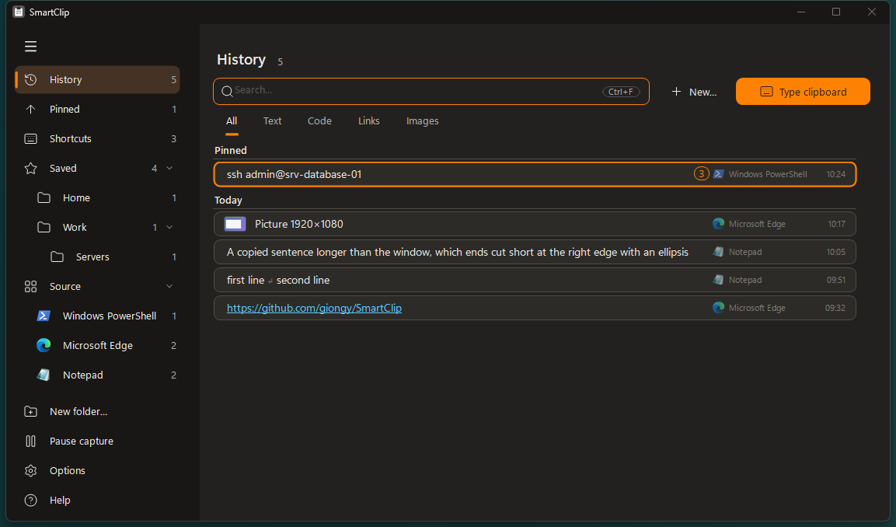

# SmartClip

[](https://github.com/giongy/SmartClip/actions/workflows/codeql.yml)

**A tiny clipboard manager that can also type the clipboard as real keystrokes, for the places where paste does
not work.**

SmartClip keeps a history of what you copied, pictures included, and the texts you choose to save. One click makes
any of them the current clipboard content again.


It also covers the moment you have a long password in your password manager and a remote login screen that ignores
Ctrl+V: remote desktop lock screens, VMware consoles, iLO / iDRAC and other KVM viewers. Instead of pasting, it
presses the keys one by one, as if you were typing.

Formerly called PasswordPaste: the first start under the new name takes over its settings and saved texts.

- One portable `.exe`, about 240 KB. No installer, no dependencies, no network access.
- A handful of C# source files in `src`, compiled with the compiler already shipped with Windows.
- Stops typing the moment the target window loses focus, so a password never lands in the wrong place.
- The history of copied items is kept for the number of days you choose, or today only; saved texts never
  expire and are encrypted for your Windows account. Everything is in one SQLite file, through the SQLite that
  comes with Windows.
- Light or dark theme, or the same as Windows sets for apps, switching on the fly: warm grey in the light,
  neutral grey in the dark, the icons of Windows itself (Segoe Fluent Icons), rounded menus, rows and buttons that
  light up gradually, thin scroll bars and the font of Windows 11 where it is installed, all without extra libraries.
- In English, Spanish, French and Italian, chosen in the options (English by default).



## Download

Get [`SmartClip.exe`](https://github.com/giongy/SmartClip/releases/latest/download/SmartClip.exe) from the
[latest release](https://github.com/giongy/SmartClip/releases/latest) and run it. It needs Windows with .NET
Framework 4, which is part of Windows 10 and 11. Each release is compiled by GitHub from the source of its tag.

The file is not code-signed, so Windows SmartScreen may warn you on first launch. If you prefer not to trust a
downloaded binary, [build it yourself](#build): it takes a few seconds and needs nothing installed.

## Usage

### Typing the clipboard

**With the button**

1. Copy the password.
2. Click **Type clipboard**.
3. Click into the password field of the remote window.
4. Once that window has stayed in the foreground for the configured delay (1 second by default), the text is typed.
   The button becomes **Cancel** while this is in progress.

If you do not pick a window within 15 seconds, nothing is typed.

**With the hotkey**

Put the cursor in the password field and press **Ctrl+Alt+V**: the clipboard is typed immediately into the active
window. A remote desktop client running full screen usually captures every shortcut; use the button in that case.

### The lists

The main window looks like the apps of Windows 11: a sidebar on the left, the entries as cards on the right. Drag
the edge of the sidebar to make it wider or narrower; the button at its top reduces it to its icons.

- **History**: what you copied, newest first, each day under its name. The entries kept at the top come first.
  Searching, the saved texts that match come after them, under **Saved**.
- **Pinned**: only the copied entries kept at the top.
- **Saved**: the texts you saved, by name, which stay until you delete them. Their folders are under it.
- **Source**: the programs you copied in, that of your latest copy first, each with its icon and how many entries come from it; choose one to see
  only what you copied there. The programs of a Citrix server all go by the name of Citrix on your PC, each with
  its own icon.

Above the cards, tabs show one kind of entry only: **All**, **Text**, **Code**, **Links**, **Images**. Code is
told from how the lines look, so now and then it guesses wrong: **Type**, in the menu of a text, says what it
is, and it stays so, also copied again or saved.

Each card is compact: the entry first, large; on its right its number, if it has one, and small and faint the
program it was copied in with its icon (or the folder of a saved text), the time and what it is, unless it is plain
text. With the pointer on the card, small signs take their place: they keep it at the top, show it whole, copy it,
save or edit it, delete it and open its menu; their tooltips name them. Copied entries are texts and pictures
(screenshots, for example), each picture with a small preview. They stay for the number of days set in the
options, also across restarts; the list shows the 200 most recent, and the search reaches the rest. Copied
pictures take at most 200 MB: beyond that the oldest go, even before their days are over, and a red bar under the
list says the room is full. Saved pictures do not count. A saved text's name is optional: with one, the card shows
only the name and the content stays hidden, which suits a password; without, the card shows the content.

| Key | Action |
| --- | --- |
| Typing | Filters the cards of the place, and in **History** finds the saved texts too. Words can come in any order; case and accents are ignored. The words found are highlighted on the cards; found far into a long text, the card shows that part of it |
| Up / Down | Moves through the cards |
| Ctrl+F | Takes the cursor to the search box, from anywhere in the window |
| Click | Selects the card |
| **Copy** | Puts the entry back on the clipboard; the window stays, so you can still save or delete it |
| Enter, or a double click | Puts the entry back on the clipboard and returns to the window you came from |
| Right click, or the three dots on the right | Opens the menu of the entry |
| The eye on the right of a card (**Preview**), also in the menu | Shows the entry whole in a small box for a few seconds: every line of a text, a larger picture; of a saved text with a name, its content. With **Preview when the pointer rests** on, resting the pointer on a card cut short does the same |
| Dragging a saved card, or a folder of the sidebar | Onto a folder of the sidebar moves it there; onto **Saved** takes it out of the folders |
| Resizing the window | The cards take the room; size and position are remembered for the next start, never smaller than the starting size |
| The arrow on the right of a copied entry, or Ctrl+P | Keeps the entry at the top for a while: it still goes when its days are over. What is to stay, save it |
| Ctrl+Shift+1 … Ctrl+Shift+9, in any program | Pastes the entry with that number into the active window, without opening SmartClip (see below) |
| F1, or **Help** at the bottom of the sidebar | Opens the guide: everything the program does, by topic |

Of a saved text the card shows the name only: **Show the content** in its menu shows the text in the same small
box for a few seconds.

**Pause capture**, at the bottom of the sidebar and in the menu of the tray icon, stops remembering what
you copy until you choose **Resume capture**. It is not a setting: the next start
always listens again.

**New…**, beside the search, and **Save…** / **Edit…** on the cards open a small window with a name, optional, and
a content box. Under the name a grey line says what the card will show.

A saved text can be **formatted**, as a mail signature is: bold, italic, underlined, fonts, sizes and colours.
Copy the signature from a mail or a document and save it, or paste it into the content box: it keeps its
formatting. The history stores plain text only, so a copied entry is saved formatted while it is among the last
10 copies since the program started. Above the content box, buttons make the selection bold (Ctrl+B), italic
(Ctrl+I) or underlined (Ctrl+U), give it a font and a size from a menu, or remove the formatting (with nothing
selected, from all the text). Chosen from the list, a formatted text goes on the clipboard as HTML, as RTF when
it came with one, and as plain text: a mail pastes it formatted, a plain field gets the text, and Ctrl+Alt+V
types the text. As long as it is not changed it stays exactly as it was copied, links and pictures included;
once edited, it is written again from what the buttons know, and links, pictures, alignment and lists are lost.

Saved texts can be gathered in folders, and folders in other folders. They are in the sidebar under **Saved**: a
click on one shows its texts, and those of the folders inside it. **New folder…** is at the bottom of the sidebar
and in the right-click menu of a folder (Ctrl+Shift+N), and creates the folder inside the one shown; **Move to** moves a saved
text or a whole folder, and the window of a text or a folder has the same choice beside its buttons. The arrow at
the right end of a folder opens and closes the folders inside it, and they are found as they were left. The
right-click menu of a folder renames or moves it, or deletes it: deleting a folder never deletes what it holds,
which moves up one level. A folder name cannot contain `\`.

The saved texts are also in the right-click menu of the tray icon, each folder a submenu: choosing one puts it
on the clipboard without opening the window. Only the names are shown there, as in the list.


| Button | Key | Action |
| --- | --- | --- |
| New… | Ctrl+N | Write a new text to keep |
| Save… / Edit… | Ctrl+S | Save the copied entry, with a name or without, or change the name or content of a saved one |
| Delete | Ctrl+E | Delete the saved text, or drop a copied entry from the list |

Once an entry is back on the clipboard, paste it with Ctrl+V as usual or type it with **Ctrl+Alt+V** where paste
does not work. Pictures can only be pasted, not typed; they can be saved like texts, and a saved picture always
shows its thumbnail, with its name beside it if it has one. **Copy the text**, in the right-click menu of a
picture, puts on the clipboard the text in it, read by the text recognition built into Windows, on your PC: it
comes into the list like any copy (from a saved picture it is marked private). Small screen text can come out with
a few mistakes.

Press **Ctrl+D** in any program to bring the window up on **History**, every kind, with your latest copy selected and the
cursor in the search box (**Open where you left it**, among the hotkeys in the options, keeps the place and the kind instead). After you choose an
entry the focus returns to the program you were in, and the window hides again if it was hidden. Esc goes back
without choosing.

### Paste by number

**Shortcut**, in the right-click menu, gives a saved text or a copied entry a number from 1 to 9. Then, in any
program, **Ctrl+Shift+1** … **Ctrl+Shift+9** pastes that entry straight into the window you are working in,
without opening SmartClip: the entry goes on the clipboard and Ctrl+V follows by itself, once you release the
keys. The number shows in a small frame at the right of the entry's row, and in the tray menu beside a saved
text. The same menu changes the number or takes it away (**None**); next to each number it says which entry has
it now. A number belongs to one entry at a time: given to another, it moves. A copied entry keeps its number until
its days are over, and the number goes with it.

Only the keys of the numbers some entry has are registered, so the others stay with the other programs. If
another program already has one of them, the status line says which, and that number does not paste: give the
entries other numbers, or the numbers other keys under **Hotkeys** in the options (press the keys to hold
together with any digit; the button says right away which of them another program uses).

## Options

The **Options** button opens the options in a window of their own, like the guide, which can stay open beside the
list; **Close** or Esc puts it away.
The options are in five pages, **Typing**, **Hotkeys**, **History**, **Appearance** and **Program**, chosen from a column on the left as in the Windows 11 Settings; each page slides into place. As there, each option is a card with its name, a few words on what it does and its control on the right; switches say **On** or **Off**. Resting the pointer
on an option shows its full explanation.


| Option | What it does |
| --- | --- |
| Wait before typing | How long the target window must stay in the foreground before typing starts, 1 to 30 seconds. This is your time to click the right field, or to cancel. |
| The server uses a US English keyboard | Leave it off for ordinary remote desktops: the layout of this PC is used. Turn it on when symbols arrive wrong because the remote side assumes a US keyboard, as VMware consoles, iLO, iDRAC and some login screens do. |
| Press Enter at the end | Press Enter after the last character. |
| Clear the clipboard after typing | Clear the clipboard after a successful run. Windows clipboard history (Win+V) is not touched. |
| Slow typing | Slow typing, for remote sessions that drop or reorder characters. |
| Alt codes for symbols with no key | Type symbols that your keyboard has no key for with Alt+numpad codes instead of Unicode input. Works only when the remote machine runs Windows. |
| Type clipboard, with a button showing **Ctrl+Alt+V** | Enable the global hotkey that types the clipboard. The button shows its keys: click it and press the new ones to change them. |
| Open the list, with a button showing **Ctrl+D** | Enable the global hotkey that brings up the window with the list. While it is on, those keys no longer reach other programs: change them with the button, or turn the hotkey off. |
| Open where you left it | Off by default: Ctrl+D always opens the list on **History**, every kind, with the search empty. On, it shows the place and the kind you left it on. |
| Paste by number, with a button showing **Ctrl+Shift+1…9** | Enable the keys that paste the numbered entries. Only the keys of the numbers in use are taken from other programs. The button takes the keys to hold: press them with any digit; it says which of the nine another program already uses. Del goes back to Ctrl+Shift. |
| Remember copied texts and pictures | Keep the copied texts and pictures in the list. Turn it off if you copy passwords from programs that do not mark them as private: they would be readable in the list. Turning it off also deletes the history on disk. |
| Days kept | For how many days, 0 to 365, what you copy stays in the history, also after the program closes, today being the first: with 0 only what was copied today stays. Entries kept at the top go too when their days are over; saved texts never do. |
| Folder of the copied and saved entries, with the buttons **Change…** and **Default** | Where the database is kept, with the error log (by default `%LOCALAPPDATA%\SmartClip`), and how much it takes, the copied pictures apart. **Change…** moves it to the folder you choose, checking the copy before deleting the old file, or uses the database already there; **Default** brings it back. A folder synchronised online or on the network asks first. It is not a way to share the list between PCs: saved texts can be read only by this Windows user on this PC. If the folder chosen cannot be reached at the start, no empty list is made in its place: the list works in memory and says so. |
| Clean the history, with a box of days and the button **Clean now…** | Deletes at once what was copied before the last days written in the box: 1 keeps only today, 0 keeps nothing. It asks first. Entries kept at the top go too; saved texts are not touched. |
| Language | English, Español, Français or Italiano. Changing it restarts SmartClip, which opens again at once on the options. |
| Theme | Same as Windows (the mode it sets for apps, followed also when it changes), Light or Dark. Changes at once. |
| Font of the interface, with its size | The font of the program itself, the same in every window: buttons, labels, options, the guide, menus and questions. Segoe UI Variable (the default where it is installed), Segoe UI, Aptos, Calibri, Arial, Verdana, Tahoma, Cascadia Mono or Consolas, among those Windows has; each is written in itself in the menu. The size goes from 12 to 16 px (13 px by default); the windows grow with the text. The program restarts to apply either. |
| Font of the entries, with its size | The font of what you copied and saved: the rows of the lists, an entry shown whole and the content of a saved text, chosen among the same fonts. The rest of the program keeps the font of the interface. The size goes from 11 to 20 px (14 px by default, the text of Windows 11). Both change at once. |
| Preview when the pointer rests | Off by default: an entry shows whole only from the eye of its card, or its menu. On, resting the pointer on a card that cuts its entry short shows it whole too. |
| Stay in the notification area (tray) | Closing or minimising the window hides it to the notification area and the hotkey keeps working. Click the icon to reopen, right-click and choose **Exit** to quit; the same menu lists the saved texts. |
| Hide when switching to another program | With the option above on, the window also goes back to the notification area when you click another program; off, it simply stays open behind the others. Never while it waits and types, nor while a window of its own (a text being written, a question) is open. |
| Start with Windows | Start SmartClip when you sign in, already hidden in the notification area (minimised, if the option above is off). It is the entry Windows shows in Task Manager > Startup apps: the switch reflects it, and follows the program if you move the `.exe`. |

A hotkey takes Ctrl or Alt, with Shift if you like, and a letter, a digit or a function key. While the button
waits for the new keys, Esc keeps the current ones and Del goes back to the default. On keyboards where AltGr
types symbols, avoid Ctrl+Alt with a letter that has one (E for the euro sign, for example): the hotkey would
fire while you type it. The key names in this page are the defaults, as the English interface writes them.

Under **Program**, the buttons **Export…** and **Import…** write the saved texts, with their folders (the
formatted ones with their HTML too), to a plain text file that Notepad opens, and read such a file back, on this
PC or another. Each asks whether to take
only the saved texts or everything, that is also what was copied (pictures are left out). The file holds the
texts **in clear**, passwords included. Importing adds to what is there: when a saved text has the name of an
existing one it asks which to keep, and copied texts already in the list are not repeated. A file exported in one
language is read in any other. The shortcut numbers of the entries are not part of the file.

Under the history options, the link **Open the data folder** opens the folder of the database and of the error log.

The tray and window icon is coloured when the clipboard holds text and grey when it does not.

Settings are stored in `HKEY_CURRENT_USER\Software\SmartClip`. Delete that key to reset them.

## Safety

- Typing stops as soon as the target window is no longer in the foreground.
- The desktop, the taskbar, the Start menu and the Alt+Tab switcher are never accepted as a target.
- A text longer than 100 characters or spanning several lines asks for confirmation first: it is probably not a
  password.
- Nothing is typed while Caps Lock is on.
- The program waits for you to release the hotkey keys before typing, so they cannot alter the output.
- Copied texts and pictures are never sent anywhere. They are kept **unencrypted** in the database
  `%LOCALAPPDATA%\SmartClip\SmartClip.db` (in the Store version, under the package's own folder in
  `%LOCALAPPDATA%\Packages`), and removed when their days expire. An entry you remove from the list is
  overwritten in the file, not only forgotten. With **Remember copied texts and pictures** off, the clipboard is
  read only when you start a run.
- What password managers and private browser windows mark as private (KeePass, Bitwarden and others do) is never
  remembered. A password typed with **Clear the clipboard after typing** on is dropped from the list and
  from the database too.
- Saved texts are in the same database, encrypted with Windows DPAPI for your user account: they cannot be read
  by another user or copied to another PC. Nothing readable is left of them in the file, not even what the
  search uses. Of those with a name only the name is shown, until you ask for the content from the right-click
  menu.
- Versions before 4.0 kept saved texts in the registry and the history in one file per day. The first start of
  4.0 copies them into the database, all at once or not at all; then the folder of the history files is deleted,
  while the saved texts stay in the registry, still encrypted, for now.
- A saved text put back on the clipboard is marked as private, so that Windows clipboard history (Win+V) and other
  clipboard managers skip it.
- When something goes wrong, what failed and where is written to `SmartClip.log` beside the database, to
  look into a problem: never what you copied or saved. The file starts again past 256 KB.
- An entry is chosen when you release Enter, so a held key cannot repeat into the window the focus returns to.

## How it works

Keys are sent as hardware scancodes through `SendInput`, which is what remote desktop clients forward to the other
side. The character-to-key map is built from the active keyboard layout with `ToUnicodeEx`, covering plain, Shift,
AltGr and Shift+AltGr combinations on the main alphanumeric block only. The numeric keypad is left out on purpose:
its decimal key turns into Delete when Num Lock is off.

A character with no key on your layout (`~` and `` ` `` on an Italian keyboard, for example) is sent as a Unicode
keystroke, or as an Alt+numpad code when that option is on. The US layout option uses a fixed table instead of the
local layout.

## Build

```
git clone https://github.com/giongy/SmartClip.git
cd SmartClip
build.cmd
```

`build.cmd` uses the `csc.exe` that ships with Windows in `%WINDIR%\Microsoft.NET\Framework64\v4.0.30319`. No Visual
Studio, SDK or package restore is involved. That compiler stops at C# 5, so the source avoids newer syntax on
purpose. Close SmartClip before building, including an instance hidden in the tray, or the output file is locked.
The few Windows Runtime calls used by the Store package take their metadata from `%WINDIR%\System32\WinMetadata`,
which Windows 10 and 11 include.

### Microsoft Store package

`packaging\pack.ps1` turns the built `SmartClip.exe` into an MSIX package for the Microsoft Store: it generates
the tile and taskbar images from `SmartClip.ico` and takes the version from `src\Program.cs`. It needs the
Windows SDK (`makeappx`, `makepri`); without it, it writes only the package layout, which can be tried with
Developer Mode on. The release workflow builds the package too and leaves it among the artifacts of the run.
From the package, SmartClip starts with Windows through a startup task instead of the `Run` key, and keeps its
history in the package's own data folder. The Store listing texts and pictures are in [`store`](store/README.md),
the privacy policy in [`PRIVACY.md`](PRIVACY.md).

## Tests

`tests\test.cmd` compiles a test executable and runs four checks:


- `tests.exe map` prints the key map of the active layout and compares the built-in US table against the installed
  US layout.
- `tests.exe texts` checks the logic behind the list: private clipboard markers, the copied texts, the search and
  the encrypted round trip of a saved text through the registry.
- `tests.exe data` checks the layer over the SQLite that comes with Windows (`winsqlite3.dll`): texts and bytes
  come back as they went in, broken rules are refused, transactions are all or nothing. It also checks the
  database of the list: copied and saved entries, numbers, days, folders, importing an exported file, and the
  migration of the registry and the history files into it, which must leave them exactly as they were.
- `tests.exe type` opens a small window and really types into it: all ASCII characters, accented letters, AltGr
  symbols, Unicode, Alt codes, Tab and Enter. It then checks that a wrong window and a cancel both stop everything.
  It takes the keyboard focus for a couple of seconds, so keep your hands off while it runs.

The checks never touch your own data: settings and saved texts go under a registry key of their own, history and
log into a temporary folder, all removed at the end. GitHub runs `test.cmd ci` (every check but typing, which
needs a desktop) at every push, before a release is made.

Three more modes are not part of `test.cmd` and only produce pictures: `tests.exe shot <prefix>` draws the windows
off screen, `tests.exe real <prefix>` shows them for a moment and photographs the screen, and
`tests.exe store <folder>` does the same on a plain background at the size the Store asks for, plus the 300 × 300
icon. After the language they take `dark` or `light`, whatever Windows has. The screenshots in this page come
from `real`.

## Limitations

- Developed and tested on an Italian keyboard layout. Other layouts are mapped by the same code but have not been
  checked one by one; dead keys in particular are untested.
- Whether a Unicode keystroke reaches the remote machine depends on the remote desktop client. If a symbol goes
  missing, try the Alt+code option or the US layout option.
- If the remote desktop client runs as administrator, Windows blocks keystrokes coming from a normal process: start
  SmartClip as administrator too.
- Display scaling above 100% has not been tested.
- Typing goes key by key, so a long text takes a while (about 30 characters per second) and line breaks are
  typed as Enter. For anything that is not a password, Ctrl+V is the better choice.

Bug reports with the client, both keyboard layouts and the character that failed are welcome in the
[issues](https://github.com/giongy/SmartClip/issues).

## License

[MIT](LICENSE)
